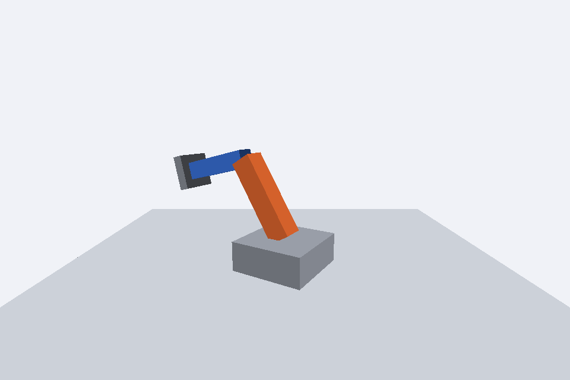

# Atividade 2: Braço Robótico

**Disciplina:** Computação Gráfica
**Atividade:** Braço Robótico (grafo de cena)
**Integrantes:**
- Gabriel de Sá Lourenço
- Lucas Cimino Alves

## Descrição
O braço é montado como um grafo de cena. O ombro é um `Object3D` (pivô) filho da base, posicionado no topo dela, e o braço laranja é filho do ombro, deslocado para cima em metade da altura para que a ponta de baixo fique na articulação. O cotovelo é outro pivô, filho do ombro, na ponta de cima do braço (altura total de 1.2). O antebraço azul é filho do cotovelo, também deslocado em metade da altura, e a garra cinza é filha do antebraço, posicionada na sua ponta. Os controles usam `self.deltaTime`: A/D giram a base em torno do eixo Y, levando todo o braço junto; W/S giram o ombro e I/K giram o cotovelo, ambos em torno do eixo Z.

## Resposta da questão
Como `caixa(...)` cria uma caixa centrada na origem local, girá-la diretamente faria ela rodar em torno do próprio centro, e não da articulação. Com um pivô (`Object3D` vazio) posicionado exatamente no ombro ou no cotovelo, a caixa fica deslocada dentro dele (metade da altura para cima) e a rotação do pivô gira a caixa em torno da ponta, como uma articulação real. Além disso, a hierarquia pai-filho faz as transformações se acumularem: ao girar o ombro, o cotovelo, o antebraço e a garra, que são seus descendentes, acompanham o movimento sem cálculo adicional.