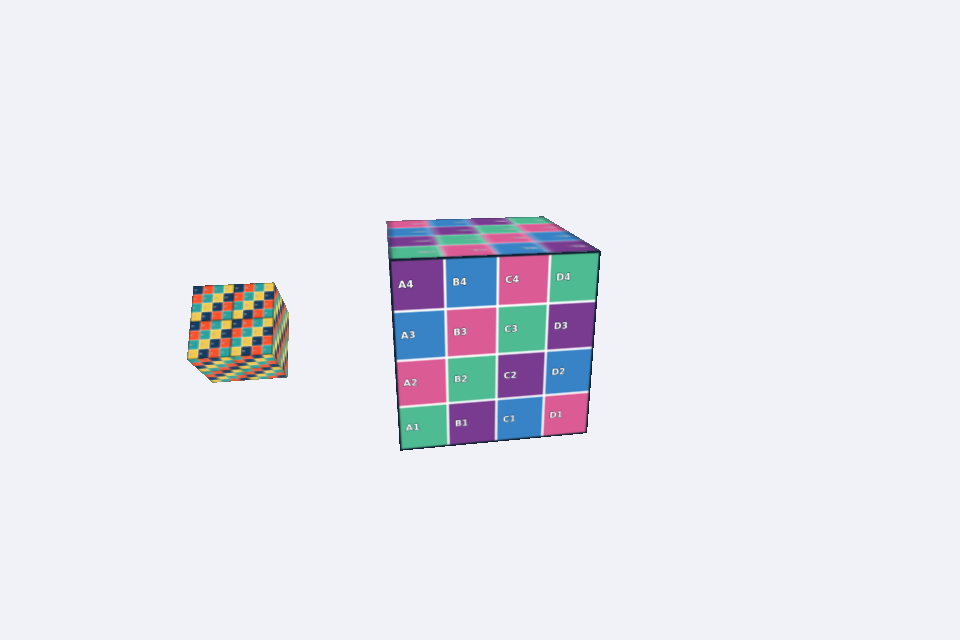

# Atividade 3: Cubo com Satélite Texturizado

**Disciplina:** Computação Gráfica
**Atividade:** Cubo com Satélite Texturizado (texturas)
**Integrantes:**
- Gabriel de Sá Lourenço
- Lucas Cimino Alves

## Descrição
O cubo principal usa a textura `mosaico.png`. O satélite é um segundo cubo com `grade_uv.png` repetida 2x2 (`repeatUV = [2,2]`), adicionado como filho do cubo principal com `self.mesh.add`. Ele é posicionado a 1.3 do centro e só depois escalado em 0.4, para que a escala não reduza a distância. Por ser filho, o satélite acompanha a rotação do cubo principal. As setas ↑ e ↓ aumentam e diminuem a velocidade de rotação do cubo, usando `self.deltaTime`, e o satélite gira em torno do próprio eixo X a 2 rad/s.

## Resposta da questão
As coordenadas UV mapeiam cada vértice do modelo 3D a uma posição na imagem da textura, com U na horizontal e V na vertical, normalmente de 0 a 1. Durante a rasterização, os valores de UV são interpolados entre os vértices e usados para escolher a cor do pixel correspondente na imagem, o que "cola" a textura na superfície. Com `repeatUV = [2,2]`, as coordenadas são multiplicadas por 2, então a imagem é repetida duas vezes em U e duas em V na mesma face, em ladrilho 2x2, e cada cópia aparece com metade do tamanho.