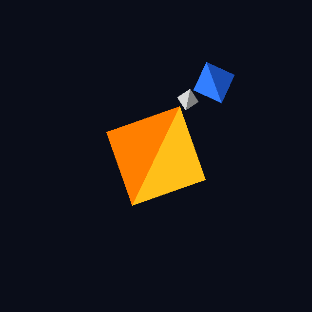

# Atividade 1: Mini Sistema Solar

**Disciplina:** Computação Gráfica
**Atividade:** Mini Sistema Solar (transformações geométricas)
**Integrantes:**
- Gabriel de Sá Lourenço
- Lucas Cimino Alves

## Descrição
O programa desenha um Sol, um planeta e uma Lua usando apenas `make_translation`, `make_rotation_z` e `make_scale`, combinadas com `@`. O Sol gira em torno do próprio centro. O planeta orbita o Sol (raio 0.6) e gira em torno do próprio eixo com velocidade diferente da órbita. A Lua orbita o planeta (raio 0.2) reaproveitando a matriz de órbita do planeta, de modo que acompanha seu movimento sem herdar a escala nem a rotação própria dele. As setas ↑ e ↓ aumentam e diminuem a velocidade da órbita, que nunca fica negativa. Todas as velocidades usam `self.deltaTime`.

## Resposta da questão
Em `R @ T @ ponto`, a matriz mais à direita é aplicada primeiro. A translação leva o planeta para a distância 0.6 do Sol e, depois, a rotação `R` gira esse ponto em torno da origem (onde está o Sol), o que produz a órbita. Já a rotação própria fica à direita da translação (`T @ Rz @ S`), então é aplicada antes dela, quando o planeta ainda está na origem, e ele gira em torno do próprio centro. Se essa rotação ficasse à esquerda da translação, ela seria aplicada depois que o planeta já estivesse deslocado, e ele passaria a girar em torno do Sol, em vez de em torno de si mesmo.